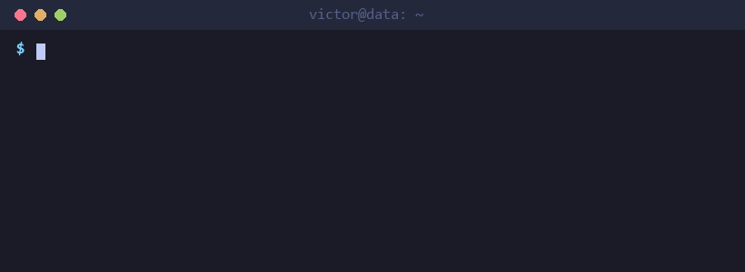

<h1 align="center">Hi, I'm Victor 👋</h1>

  <b>Data Analyst @ PicPay</b> · Product Analytics · Open Finance · ML 
  Turning big, messy fintech data into decisions — with SQL, PySpark and a bit of machine learning.

  
  
  

### 🧭 About me

- 📊 **3+ years** in Product Analytics, Open Finance and Growth — always inside fintechs (PicPay, Toro Investimentos, Mobills)
- 🏦 Led a project mapping **173M bank accounts across 66M users**, ranking each user's primary account with **LightGBM**
- 📈 Drove a **40% revenue increase** on a lending product through A/B and fakedoor testing
- 🤖 Built **Claude Code Skills** so product teams can run their own analyses without waiting on data
- 🎓 MBA in Data & Decision Science · B.Eng. in Mechanical Engineering
- 🌎 Portuguese (native) · English · Spanish

### 🛠️ Tech stack

  
  
  
  
  
  
  
  
  
  
  
  
  
  
  
  
  
  

### 🚀 Featured projects

| Project | What it is | Stack |
|---|---|---|
| 🇧🇷 [**econ-br**](https://github.com/VictorOS1997/econ-br) | Brazilian economy observatory: BCB & IBGE data pipeline → DuckDB → Streamlit dashboard | Python · DuckDB · Streamlit |
| 🔍 [**needle-in-the-haystack**](https://github.com/VictorOS1997/needle-in-the-haystack) | Data quality investigation of Q4 2024 daily sales data | Python · Pandas |

> 💼 Case studies in **fraud detection**, **AML/CFT** and **Power BI** are kept private — happy to walk through them, just reach out.

### 📊 GitHub stats

  
  

---

<i>Open to Data Engineering, Data Science and Product/Growth Analytics roles — remote.</i>

